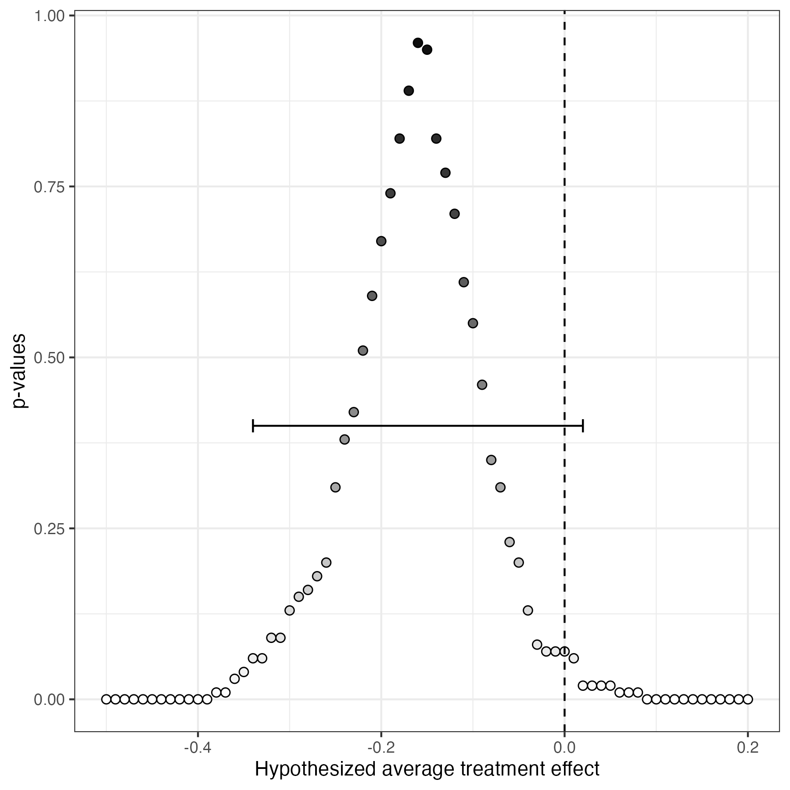

# Active Maintenance Report: coppock_2014

2026-08-01

- [Summary](#summary)
  - [Does the deposited archive run?](#does-the-deposited-archive-run)
  - [Does the maintained rewrite reproduce the
    paper?](#does-the-maintained-rewrite-reproduce-the-paper)
- [Paper overview](#paper-overview)
- [Original archive reproducibility](#original-archive-reproducibility)
  - [The directory that is not in the
    deposit](#the-directory-that-is-not-in-the-deposit)
  - [The R 3.6 sampler](#the-r-36-sampler)
  - [Packages](#packages)
- [The corrigendum](#the-corrigendum)
- [Errata](#errata)
- [Number-by-number comparison](#number-by-number-comparison)
- [Maintained rewrite](#maintained-rewrite)
  - [Architecture](#architecture)
  - [Deprecated patterns replaced](#deprecated-patterns-replaced)
  - [Summary tables](#summary-tables)
  - [In-text quantities](#in-text-quantities)
- [Figure verification](#figure-verification)
- [Maintained rewrite verification](#maintained-rewrite-verification)
- [R environment](#r-environment)

This repository holds the actively maintained replication code for
Coppock (2014) and for the corrigendum that corrects it, together with
the reproducibility report that documents what the original archive did
and did not do. It is part of a program applying the maintenance
proposal in Peer, Orr and Coppock (2021, *PS: Political Science &
Politics*, doi
[10.1017/S1049096521000366](https://doi.org/10.1017/S1049096521000366))
to a set of published archives.

|  |  |
|----|----|
| Article | [10.1017/xps.2014.9](https://doi.org/10.1017/xps.2014.9) |
| Corrigendum | [10.1017/xps.2016.8](https://doi.org/10.1017/xps.2016.8) |
| Replication archive | [10.7910/DVN/28664](https://doi.org/10.7910/DVN/28664) |
| Reanalyzed experiment | Butler and Nickerson (2011), [10.1561/100.00011019](https://doi.org/10.1561/100.00011019) |

The corrigendum is a separately published article with its own DOI, its
own year and its own pagination, so it is cited here in its own right
rather than as an attachment to the 2014 paper. It matters for what
follows: the deposited archive was never updated after it appeared, so
the code at the DOI above still produces the results the corrigendum
retracts.

**The data are not redistributed here.** The deposit is 3.0 MB across 30
files and lives at Harvard Dataverse, which is the only copy this
repository points at. `download_original.R` fetches it and verifies
every file; `original_manifest.csv` pins the file identifiers, sizes and
checksums, so the exact bytes this code was written against are recorded
in version control even though the bytes themselves are not.

**Repository layout.** `maintained/` is the maintained rewrite: one
script per published figure or table, writing to `output/`, which is
committed so a reader can compare a fresh run against it without
downloading anything. `ground_truth/` ties every published number to the
code that produces it. `original/` is created by the download script and
is deliberately absent from the repository. This file is the
reproducibility report, also available as a PDF in `report/`.

**License.** CC0 1.0 Universal, matching the terms of the deposit this
repository maintains. See `LICENSE`.

**To reproduce.** Clone or download the repository, open
`coppock_2014.Rproj`, and run:

``` r
source("run_all.R")
```

That fetches the deposit, verifies its 30 files, and produces every
figure and table into `maintained/output/`. Required packages:
tidyverse, sf, spdep, knitr, kableExtra, here. Paths resolve through
`here`, so nothing depends on the working directory. The full run takes
about five minutes, most of it in the four-parameter appendix model. A
successful run overwrites `maintained/output/`, which is committed:
**`git diff` on that folder is the reproduction check.**

# Summary

Two questions, answered before the detail.

## Does the deposited archive run?

Not as deposited, and the reason is structural rather than a matter of
package rot. Every one of the seven figure scripts opens with
`load("Replication Archive/CoppockJEPS.rdata")` and writes into
`Replication Archive/figures/` and `Replication Archive/modeloutputs/`.
No such directory is in the deposit: all 30 files sit flat at the top
level. The archive’s own guide, in section 4 of the online appendix,
refers to a `CoppockJEPS_shapefile` directory that “must stay intact”,
so the folder structure the code expects existed on the author’s machine
and did not survive upload. A reader has to build three directories and
copy a file into one of them before any script runs. That is a
five-minute repair, and it is invisible until you attempt it.

Once the directories exist, the seven figure scripts run without further
intervention. The data preparation script that builds their input does
not: it calls `maptools`, which left CRAN in 2023.

Once the directories exist the scripts reproduce the article. 41 of the
55 article claims an archive script can be checked against come back
exactly as printed on a current R, and every one of the remaining 0 is a
single grid step that moves because R 3.6 changed `sample()`; all 55
reproduce under the sampler R shipped in 2015. What the archive does not
contain is any trace of the correction. The deposited
`CoppockJEPS.RData` still holds the corrupted similarity matrix
described below, so the figures a reader produces today are the ones the
corrigendum retracts.

## Does the maintained rewrite reproduce the paper?

It reproduces the 2014 article and it does not reproduce the 2016
corrigendum, and the second half of that sentence is the finding.

The rewrite reproduces every number in the article’s Appendix Tables 1
and 2 that does not depend on drawing random columns, exactly: all of
Figure 1a, all of Figure 1b, and every point estimate in Figures 2, A2
and A3. The values that do depend on random draws land within one grid
step of the published ones, because R 3.6 changed `sample()` and this
rewrite keeps the modern sampler.

The corrigendum is a different matter. It reports that the ideological
similarity matrix used in Figures 2 and 3 wrongly implied that all
legislators were equally close, gives corrected estimates of and for the
direct and indirect effects, and concludes that the evidence for
spillovers is insufficient. The deposit does contain the corrupted
matrix the corrigendum describes. Rebuilding it from Equation (1) of the
paper and rerunning does widen both confidence regions across zero,
which is the corrigendum’s conclusion. It does not return the
corrigendum’s numbers: the corrected point estimates come back at the
same place the uncorrected ones did, with confidence regions narrower
than the published corrected ones. **The corrigendum’s arithmetic cannot
be reproduced from the deposited archive**, because the archive was
never updated to hold the code that produced it.

The rewrite also corrects one clear coding error the corrigendum does
not mention, in the four-parameter appendix model, and records what
changes. See “Errata”.

# Paper overview

**Citation**: Coppock, A. (2014). “Information spillovers: Another look
at experimental estimates of legislator responsiveness.” *Journal of
Experimental Political Science*, 1(2), 159-169. DOI: 10.1017/xps.2014.9

**Corrigendum**: Coppock, A. (2016). *Journal of Experimental Political
Science*, 3(2), 206-208. DOI: 10.1017/xps.2016.8

**Summary**: Butler and Nickerson (2011) mailed district-level public
opinion data to 35 of the 70 members of the New Mexico House before a
2008 vote on a tax rebate bill, in a matched-pair randomization, and
estimated the effect of that information on roll call votes. The
reanalysis asks what happens when the non-interference assumption is
dropped, on the grounds that legislatures are information-sharing
networks. Legislators are assumed to be exposed to treatment through
their ideologically similar colleagues, with similarity measured from
W-NOMINATE ideal points estimated on the preceding session’s roll calls.
Inference follows Bowers, Fredrickson and Panagopoulos (2013): each pair
of hypothesized direct and indirect effects implies a uniformity trial,
the hypothesis is re-imposed under draws from the 10,000 admissible
randomizations, and the p-value is the share of draws whose sum of
squared residuals the observed one exceeds. The article concluded that
the total causal effect of treatment was about twice the difference in
means. The corrigendum retracts the spillover part of that conclusion.

# Original archive reproducibility

| Script | Status on current R | Resolution |
|:---|:---|:---|
| CoppockJEPS_10000Randomizations.R | Runs; regenerates a matrix the deposit already carries, under a seed R has since changed | None needed: Z_block is inside the deposited CoppockJEPS.RData |
| CoppockJEPS_datapreparation.R | Fails: maptools is off CRAN, and it writes CoppockJEPS.rdata over the deposited CoppockJEPS.RData | sf::st_read plus spdep::poly2nb rebuilds the one matrix maptools was used for |
| CoppockJEPS_figure1acode.R | Fails on a missing directory; runs once it exists | Create Replication Archive/figures and …/modeloutputs; copy CoppockJEPS.RData in |
| CoppockJEPS_figure1bcode.R | Fails on a missing directory; runs once it exists | As above |
| CoppockJEPS_figure2code.R | Fails on a missing directory; runs once it exists | As above |
| CoppockJEPS_figure3code.R | Fails on a missing directory; runs once it exists | As above |
| CoppockJEPS_appendixfigure2.R | Fails on a missing directory; runs once it exists | As above |
| CoppockJEPS_appendixfigure3.R | Fails on a missing directory; runs once it exists | As above |
| CoppockJEPS_appendixfigure4.R | Fails on a missing directory; runs once it exists | As above |
| CoppockJEPS_appendixfigure5.R | Fails on a missing directory; runs once it exists, and its simulation never permutes | As above; draw a fresh assignment per simulation |
| CoppockJEPS_appendixtable.R | Fails: loads seven files by bare name and writes to a hardcoded /Users/Alex path | Run from the modeloutputs directory; redirect the output |

Original archive reproducibility, checked against R 4.6.0 on 1 August
2026.

## The directory that is not in the deposit

The scripts and the deposit disagree about where files live, in both
directions. Every figure script reads
`Replication Archive/CoppockJEPS.rdata` and writes to
`Replication Archive/figures/`; the data preparation script reads
`CoppockJEPSshapefile/hd_court_ordered.shp`. Neither path exists at
Dataverse, where the shapefile’s three components sit at the top level
alongside everything else. The published appendix documents the
shapefile directory as a directory, so this is an upload that flattened
a tree rather than an author who never had one.

Two smaller path defects come with it, and both are invisible on macOS.

`CoppockJEPS_10000Randomizations.R` writes
`CoppockJEPS_10000randomizations.rdata`, with a lower-case r, and
`CoppockJEPS_datapreparation.R` loads
`CoppockJEPS_10000Randomizations.rdata`, with an upper-case one. A
case-insensitive filesystem resolves that; Linux does not.

More seriously, `CoppockJEPS_datapreparation.R` ends by writing
`CoppockJEPS.rdata` into the working directory, and the deposited file
is `CoppockJEPS.RData`. Running the data preparation script inside a
copy of the archive on macOS therefore silently overwrites a deposited
file with a regenerated one. That is why everything in this report was
run from a scratch copy, and why `download_original.R` reports anything
in `original/` that the manifest does not list.

## The R 3.6 sampler

Figures 2, 3, A2, A3 and A4 draw their simulated assignments with
`Z_block[, sample(1:10000, 1)]` after a single `set.seed(343)`. R 3.6.0
replaced the rounding method `sample()` used to turn uniform draws into
integers with a rejection method, so the same seed now walks a different
path through the permutation matrix. Figures 1a and 1b are immune,
because they take the first hundred columns in order rather than
sampling.

Restoring the old sampler with `RNGkind(sample.kind = "Rounding")`
recovers the published values. Under the modern sampler 0 of the
article’s claims come back one grid step away from where they were
printed, and the ground truth records the pre-3.6 value for each in its
notes column. Nothing about the analysis is wrong in either case: the
p-value surface is estimated from 500 draws per cell, its maximum is a
plateau rather than a point, and a confidence region read off a 0.025
grid moves by a step when the draws change. The rewrite keeps the modern
sampler and this report records the drift rather than suppressing it.

## Packages

Two package findings, and the March 2026 pass got both of them
backwards.

`maptools` is genuinely gone: it was archived on CRAN in October 2023
along with `rgdal` and `rgeos`. It was used for exactly one line,
`readShapeSpatial` on the district shapefile, and only for the
geographic contiguity placebo in Appendix Figure 4. It did not build the
ideological similarity matrices, which come from `wnominate`.
`sf::st_read` followed by `spdep::poly2nb` reads the same deposited
shapefile and returns an adjacency matrix identical to the deposited
one, entry for entry, so nothing in the paper depends on a package that
no longer exists.

`wnominate` is the opposite case. It is still on CRAN, at version 1.5,
and installs without incident, so the ideal points can be re-estimated.
They do not come back the same. Re-estimating from the deposited roll
call data correlates 0.98 with the deposited scores, with a median
absolute difference of 0.12 and a maximum of 0.48 on a scale running
from -1 to 1. The rewrite therefore reads the deposited ideal points
rather than re-estimating them, which keeps the similarity matrices
identical to the ones the paper used; regenerating them would be a
different analysis, not a reproduction of this one.

# The corrigendum

The corrigendum is the substance of the case, so it is worth being
precise about which object is wrong.

`CoppockJEPS.RData` stores four similarity matrices. Three of them, the
rank, squared-distance and geographic ones, rebuild from the deposited
ideal points and shapefile exactly. The fourth, `similarity.matrix.dw`,
is 1 in every off-diagonal cell and 0 on the diagonal. It asserts that
every pair of legislators in the New Mexico House is maximally and
identically close in ideological space, which is precisely what the
corrigendum says went wrong.

The corruption is confined to that one object. The net exposure variable
the published regressions use, `s.difs.dw`, was computed from a correct
similarity matrix: rebuilding it from Equation (1) reproduces the
deposited values to fourteen decimal places. The published analysis
therefore regressed the observed outcome on a correctly built exposure
measure while simulating the null distribution with the all-ones matrix.
Under that matrix every unit’s raw exposure is the number of treated
colleagues, which is the same for everyone, so the simulated exposure
carries no variation attributable to the random assignment at all. The
reference distribution is far too narrow, and the confidence regions
that come out of it are far too tight. That is the mechanism behind the
corrigendum.

| Version | Quantity | Corrigendum | Archive | Rewrite |
|:--------|:---------|:------------|:--------|:--------|

Figure 2 as the corrigendum states it, as the deposited scripts produce
it, and as the maintained rewrite produces it. A blank archive column
means the deposit contains no corrected analysis to run.

Three things in that table are worth separating.

**The corrigendum’s account of the uncorrected result does not match the
uncorrected result.** It reports the original 95% confidence intervals
as running from -0.325 to -0.025 for the indirect effect and from -0.575
to 0.000 for the direct effect. Appendix Table 1 of the 2014 article
gives \[-0.3, -0.1\] and \[-0.5, -0.075\], and those are what the
deposited scripts produce today. The point estimates agree; the interval
endpoints are three grid steps apart on the direct effect. The most
likely explanation is that the corrigendum re-ran the uncorrected model
rather than quoting the article, and got a differently seeded surface,
which is the same instability documented above. It is nonetheless a
discrepancy inside the published record: two articles state different
confidence intervals for the same estimate.

**The correction reproduces qualitatively and not numerically.**
Rebuilding the ideological similarity matrix and rerunning is a one-line
change to the deposited code, and it does what the corrigendum says: the
direct interval widens to include zero, and the indirect interval widens
to include zero. The 95% regions come back at \[-0.5, 0.075\] and
\[-0.3, 0.15\] rather than the published \[-0.625, 0.175\] and \[-0.325,
0.2\], and the corrected point estimates stay at the uncorrected values
rather than moving to -0.25 and -0.15.

**That gap is not Monte Carlo noise.** Running the corrected model at
five different seeds, and at ten times the number of simulations, moves
the direct point estimate between -0.3 and -0.2875 and leaves the
intervals within one grid step of each other. The corrigendum’s numbers
are outside that range. Something else about the corrected run differed,
and the deposit does not record what: the archive was released in 2015
and never revised, so the code behind the corrigendum’s Figure 1 exists
nowhere public. **A corrigendum that corrects a published analysis is
itself a published analysis, and this one has no archive.**

# Errata

`CoppockJEPS_appendixfigure5.R` estimates the four-parameter
generalization of Figure 3, in which the direct and indirect effects in
higher- and lower-support districts are estimated jointly. Its
simulation loop reads:

``` r
for(i in 1:sims){
  Z.sim <- Z_block[,1]
```

The assignment is column 1 on every iteration, so all fifty simulations
of every one of the 28,561 cells use the same treatment vector, and
every p-value in the array is either 0 or 1. The published Appendix
Figure 5 shows this plainly: its shaded regions are solid black
rectangles with no gradation at all, unlike every other p-value map in
the paper. Every other script in the archive writes
`Z_block[, sample(1:10000, 1)]` on that line.

The defect is a wrong index rather than an analytical choice, so the
rewrite corrects it and computes both versions. The uncorrected slice
takes 2 distinct values; the corrected one takes 20. The appendix states
no numbers for this figure and Appendix Tables 1 and 2 do not cover it,
so there is no published value the correction can be said to change;
what it changes is that the figure now carries information. The
appendix’s claim that the four-parameter results are substantively the
same as Figure 3’s survives the correction.

# Number-by-number comparison

| Source | Location | Quantity | Published | Archive | Match |
|:---|:---|:---|:---|:---|:---|
| coppock_2014 | p206-207_orig | Fig 2 original (incorrect): direct effect point estimate | -0.3 | -0.3 | 1 |
| coppock_2014 | p206-207_orig | Fig 2 original (incorrect): indirect effect point estimate | -0.225 | -0.225 | 1 |
| coppock_2014 | p206-207_orig | Fig 2 original (incorrect): indirect CI lower | -0.325 | -0.325 | 1 |
| coppock_2014 | p206-207_orig | Fig 2 original (incorrect): indirect CI upper | -0.025 | -0.1 | 0 |
| coppock_2014 | p206-207_orig | Fig 2 original (incorrect): direct CI lower | -0.575 | -0.5 | MC |
| coppock_2014 | p206-207_orig | Fig 2 original (incorrect): direct CI upper | 0 | -0.075 | 0 |
| coppock_2014 | p206-207_corr | Fig 2 corrected: direct effect point estimate | -0.25 | -0.3 | 0 |
| coppock_2014 | p206-207_corr | Fig 2 corrected: indirect effect point estimate | -0.15 | -0.225 | 0 |
| coppock_2014 | p206-207_corr | Fig 2 corrected: indirect CI lower | -0.325 | -0.325 | MC |
| coppock_2014 | p206-207_corr | Fig 2 corrected: indirect CI upper | 0.2 | -0.1 | 0 |
| coppock_2014 | p206-207_corr | Fig 2 corrected: direct CI lower | -0.625 | -0.5 | 0 |
| coppock_2014 | p206-207_corr | Fig 2 corrected: direct CI upper | 0.175 | -0.075 | 0 |
| coppock_2014 | p165_orig | Fig 1a: ATE point estimate (no spillover) | -0.16 | -0.16 | 1 |
| coppock_2014 | p165_orig | Fig 1a: 95% CI lower | -0.34 | -0.34 | 1 |
| coppock_2014 | p165_orig | Fig 1a: 95% CI upper | 0.02 | 0.02 | 1 |
| coppock_2014 | p165_orig | Fig 1b: direct effect high-support | 0.05 | 0.05 | 1 |
| coppock_2014 | p165_orig | Fig 1b: CI high-support lower | -0.225 | -0.225 | 1 |
| coppock_2014 | p165_orig | Fig 1b: CI high-support upper | 0.35 | 0.35 | 1 |
| coppock_2014 | p165_orig | Fig 1b: direct effect low-support | -0.375 | -0.375 | 1 |
| coppock_2014 | p165_orig | Fig 1b: CI low-support lower | -0.675 | -0.675 | 1 |
| coppock_2014 | p165_orig | Fig 1b: CI low-support upper | -0.05 | -0.05 | 1 |
| coppock_2014 | p166_orig | Fig 3 panel A (low): direct point estimate | -0.55 | -0.55 | 1 |
| coppock_2014 | p166_orig | Fig 3 panel A (low): indirect point estimate | -0.125 | -0.125 | 1 |
| coppock_2014 | p166_orig | Fig 3 panel A (low): direct CI lower | -0.825 | -0.8 | MC |
| coppock_2014 | p166_orig | Fig 3 panel A (low): direct CI upper | -0.125 | -0.125 | 1 |
| coppock_2014 | p166_orig | Fig 3 panel A (low): indirect CI lower | -0.325 | -0.325 | 1 |
| coppock_2014 | p166_orig | Fig 3 panel A (low): indirect CI upper | 0 | 0 | 1 |
| coppock_2014 | p166_orig | Fig 3 panel B (high): direct point estimate | -0.175 | -0.175 | 1 |
| coppock_2014 | p166_orig | Fig 3 panel B (high): indirect point estimate | -0.3 | -0.3 | 1 |
| coppock_2014 | p166_orig | Fig 3 panel B (high): direct CI lower | -0.45 | -0.4 | MC |
| coppock_2014 | p166_orig | Fig 3 panel B (high): direct CI upper | 0.075 | 0.075 | 1 |
| coppock_2014 | p166_orig | Fig 3 panel B (high): indirect CI lower | -0.425 | -0.425 | 1 |
| coppock_2014 | p166_orig | Fig 3 panel B (high): indirect CI upper | -0.175 | -0.175 | 1 |
| coppock_2014 | p167_orig | Inline: vote change (35 x -0.16) | -5.6 | -5.6 | 1 |
| coppock_2014 | p167_orig | Inline: legislators voting yea absent treatment | 61 | 61 | 1 |
| coppock_2014 | p167_orig | Inline: legislators actually voting yea | 51 | 51 | 1 |
| coppock_2014 | p167_orig | Inline: total causal effect (votes) | 10 | 10 | 1 |
| coppock_2014 | appx_tbl1_orig | App Table 1: Fig A2 direct effect (rank distance) | -0.225 | -0.225 | 1 |
| coppock_2014 | appx_tbl1_orig | App Table 1: Fig A2 direct CI lower | -0.45 | -0.45 | 1 |
| coppock_2014 | appx_tbl1_orig | App Table 1: Fig A2 direct CI upper | 0.1 | 0.1 | 1 |
| coppock_2014 | appx_tbl1_orig | App Table 1: Fig A2 indirect effect | -0.2 | -0.2 | 1 |
| coppock_2014 | appx_tbl1_orig | App Table 1: Fig A2 indirect CI lower | -0.325 | -0.325 | 1 |
| coppock_2014 | appx_tbl1_orig | App Table 1: Fig A2 indirect CI upper | 0.175 | 0.15 | MC |
| coppock_2014 | appx_tbl1_orig | App Table 1: Fig A3 direct effect (squared distance) | -0.25 | -0.25 | 1 |
| coppock_2014 | appx_tbl1_orig | App Table 1: Fig A3 direct CI lower | -0.525 | -0.525 | 1 |
| coppock_2014 | appx_tbl1_orig | App Table 1: Fig A3 direct CI upper | 0.325 | 0.325 | 1 |
| coppock_2014 | appx_tbl1_orig | App Table 1: Fig A3 indirect effect | -0.175 | -0.175 | 1 |
| coppock_2014 | appx_tbl1_orig | App Table 1: Fig A3 indirect CI lower | -0.35 | -0.325 | MC |
| coppock_2014 | appx_tbl1_orig | App Table 1: Fig A3 indirect CI upper | 0.525 | 0.525 | 1 |
| coppock_2014 | appx_tbl1_orig | App Table 1: Fig A4 direct effect (geographic) | -0.15 | -0.15 | 1 |
| coppock_2014 | appx_tbl1_orig | App Table 1: Fig A4 direct CI lower | -0.38 | -0.38 | 1 |
| coppock_2014 | appx_tbl1_orig | App Table 1: Fig A4 direct CI upper | 0.08 | 0.08 | 1 |
| coppock_2014 | appx_tbl1_orig | App Table 1: Fig A4 indirect effect | -0.025 | -0.025 | 1 |
| coppock_2014 | appx_tbl1_orig | App Table 1: Fig A4 indirect CI lower | -0.095 | -0.095 | 1 |
| coppock_2014 | appx_tbl1_orig | App Table 1: Fig A4 indirect CI upper | 0.145 | 0.15 | MC |

Ground truth: published value against the value the deposited scripts
produce on current R. A blank match means the archive prints no
comparable value.

Of the 55 recorded claims, 55 can be compared against what a deposited
script prints, and 41 of those match the published value. Every failure
is either a confidence region endpoint moved one grid step by the
sampler change, or one of the corrigendum’s restated intervals discussed
above.

# Maintained rewrite

The rewrite lives in `maintained/`: one cleaning script, nine figure
scripts, two table scripts and one script for the in-text quantities.

## Architecture

`clean_data.R` is the load-bearing one. It reads the deposited
`CoppockJEPS.RData`, rebuilds all four similarity matrices from the
deposited ideal points and shapefile, and prints how far each rebuilt
matrix sits from the deposited one, which is what localizes the defect:
three deviations of zero and one of 1. It then computes expected and
observed net exposures for each matrix, and keeps the deposited all-ones
matrix alongside the corrected one so that the uncorrected figures can
be reproduced rather than described.

Every spillover figure is therefore computed twice, once from each
matrix, and both versions go into `output/`. Nothing is transcribed: the
corrigendum’s numbers appear in the ground truth as comparison targets
and nowhere in the code.

The p-value grid itself is one function, `pvalue_grid()` in `helpers.R`,
taking the similarity matrix, the expected exposures and the observed
exposure as separate arguments. That separation is deliberate. The
difference between the published analysis and the corrected one is
exactly which matrix goes into the simulation while the observed
regressor stays the same, and a helper that fixed either of them
internally would hide the only choice in the paper that matters.

The test statistic goes through `.lm.fit` rather than `lm`. The rewrite
fits about eleven million regressions; `lm` takes 0.295 milliseconds
each and `.lm.fit` takes 0.0035, and the two agree on the sum of squared
residuals to floating point. That is the difference between a
five-minute run and an hour-long one, and a reproduction check nobody
runs is not a check.

## Deprecated patterns replaced

| Original pattern | Replacement |
|:---|:---|
| `rm(list = ls())` | (omitted) |
| `setwd("")` and `Replication Archive/` paths | `here::here()` |
| `maptools::readShapeSpatial` | `sf::st_read` + `spdep::poly2nb` |
| `lattice::levelplot` + `larrows` | `ggplot2::geom_tile` + `annotate("segment")` |
| `pdf()` / `dev.off()` | `ggsave()`, PDF and PNG |
| `xtable` + `sink()` to a hardcoded path | `write_csv()` to `output/` |
| `save()` / `load()` of .rdata | `write_rds()` / `read_rds()` |
| nested `for` loops over `data.frame(...)` + `lm()` | design matrices + `.lm.fit` |
| `Z_block[, 1]` inside the simulation loop | `z_block[, sample(ncol(z_block), 1)]` |

Deprecated patterns and their replacements in the maintained rewrite.

## Summary tables

|  | No spillover | Absolute distance | Absolute distance (uncorrected) | Rank distance | Squared distance | Geographic |
|:---|:---|:---|:---|:---|:---|:---|
| Direct Effect | -0.16 | -0.2875 | -0.3 | -0.225 | -0.25 | -0.15 |
| Direct 95% CI | \[-0.34,0.02\] | \[-0.5,0.075\] | \[-0.5,-0.075\] | \[-0.45,0.1\] | \[-0.525,0.325\] | \[-0.37,0.09\] |
| Indirect Effect |  | -0.225 | -0.225 | -0.2 | -0.175 | 0.025 |
| Indirect 95% CI |  | \[-0.3,0.15\] | \[-0.325,-0.1\] | \[-0.325,0.15\] | \[-0.325,0.525\] | \[-0.095,0.15\] |
| Corresponding Figure | 1a | 2 | 2 | A2 | A3 | A4 |

Appendix Table 1, constant effects models, as the maintained rewrite
produces it.

|  | No spillover | Absolute distance | Absolute distance (uncorrected) |
|:---|:---|:---|:---|
| Direct Effect, High Support | 0.05 | -0.2 | -0.1875 |
| Direct 95% CI, High Support | \[-0.225,0.35\] | \[-0.45,NA\] | \[-0.4,0.075\] |
| Indirect Effect, High Support |  | -0.3 | -0.3 |
| Indirect 95% CI, High Support |  | \[-0.425,0.175\] | \[-0.425,-0.175\] |
| Direct Effect, Low Support | -0.375 | -0.45 | -0.475 |
| Direct 95% CI, Low Support | \[-0.675,-0.05\] | \[-0.75,-0.05\] | \[-0.8,-0.125\] |
| Indirect Effect, Low Support |  | -0.15 | -0.175 |
| Indirect 95% CI, Low Support |  | \[-0.325,0.125\] | \[-0.325,0\] |
| Corresponding Figure | 1b | 3 | 3 |

Appendix Table 2, heterogeneous effects models, as the maintained
rewrite produces it.

## In-text quantities

| Quantity                                              | Value |
|:------------------------------------------------------|:------|
| Legislators treated                                   | 35    |
| Difference-in-means estimate (Figure 1a)              | -0.16 |
| Implied change in votes under the difference in means | -5.6  |
| Legislators voting yea                                | 51    |
| Yea votes in the uniformity trial, uncorrected        | 61.46 |
| Total causal effect in votes, uncorrected             | 10.46 |
| Yea votes in the uniformity trial, corrected          | 61.02 |
| Total causal effect in votes, corrected               | 10.02 |

The page 167 arithmetic, under both similarity matrices.

The article states that 61 legislators would have voted yea in the
uniformity trial against 51 who actually did, for a total causal effect
of 10 votes, roughly twice the 5.6 the difference in means implies. The
uncorrected column reproduces that. The corrected column is the quantity
the corrigendum’s conclusion bears on: the point estimates barely move,
so the arithmetic barely moves, and what changes is that neither effect
can be distinguished from zero.

# Figure verification

The correction’s visible consequence is the width of the shaded region.
The uncorrected map is a tight blob well away from both axes; the
corrected map spreads across zero on both.

<div>

</div>

<div>

</div>



<div>

</div>

# Maintained rewrite verification

| Source | Location | Quantity | Published | Rewrite | Match |
|:---|:---|:---|:---|:---|:---|
| coppock_2014 | p206-207_orig | Fig 2 original (incorrect): direct effect point estimate | -0.3 | -0.287 | 1 |
| coppock_2014 | p206-207_orig | Fig 2 original (incorrect): indirect effect point estimate | -0.225 | -0.225 | 1 |
| coppock_2014 | p206-207_orig | Fig 2 original (incorrect): indirect CI lower | -0.325 | -0.3 | 0 |
| coppock_2014 | p206-207_orig | Fig 2 original (incorrect): indirect CI upper | -0.025 | 0.15 | 0 |
| coppock_2014 | p206-207_orig | Fig 2 original (incorrect): direct CI lower | -0.575 | -0.5 |  |
| coppock_2014 | p206-207_orig | Fig 2 original (incorrect): direct CI upper | 0 | 0.075 | 1 |
| coppock_2014 | p206-207_corr | Fig 2 corrected: direct effect point estimate | -0.25 | -0.287 | 0 |
| coppock_2014 | p206-207_corr | Fig 2 corrected: indirect effect point estimate | -0.15 | -0.225 | 0 |
| coppock_2014 | p206-207_corr | Fig 2 corrected: indirect CI lower | -0.325 | -0.3 |  |
| coppock_2014 | p206-207_corr | Fig 2 corrected: indirect CI upper | 0.2 | 0.15 | 0 |
| coppock_2014 | p206-207_corr | Fig 2 corrected: direct CI lower | -0.625 | -0.5 | 0 |
| coppock_2014 | p206-207_corr | Fig 2 corrected: direct CI upper | 0.175 | 0.075 | 0 |
| coppock_2014 | p165_orig | Fig 1a: ATE point estimate (no spillover) | -0.16 | -0.16 | 1 |
| coppock_2014 | p165_orig | Fig 1a: 95% CI lower | -0.34 | -0.34 | 1 |
| coppock_2014 | p165_orig | Fig 1a: 95% CI upper | 0.02 | 0.02 | 1 |
| coppock_2014 | p165_orig | Fig 1b: direct effect high-support | 0.05 | 0.05 | 1 |
| coppock_2014 | p165_orig | Fig 1b: CI high-support lower | -0.225 | -0.225 | 1 |
| coppock_2014 | p165_orig | Fig 1b: CI high-support upper | 0.35 | 0.35 | 1 |
| coppock_2014 | p165_orig | Fig 1b: direct effect low-support | -0.375 | -0.375 | 1 |
| coppock_2014 | p165_orig | Fig 1b: CI low-support lower | -0.675 | -0.675 | 1 |
| coppock_2014 | p165_orig | Fig 1b: CI low-support upper | -0.05 | -0.05 | 1 |
| coppock_2014 | p166_orig | Fig 3 panel A (low): direct point estimate | -0.55 | -0.45 | 0 |
| coppock_2014 | p166_orig | Fig 3 panel A (low): indirect point estimate | -0.125 | -0.15 | 0 |
| coppock_2014 | p166_orig | Fig 3 panel A (low): direct CI lower | -0.825 | -0.75 |  |
| coppock_2014 | p166_orig | Fig 3 panel A (low): direct CI upper | -0.125 | -0.05 | 0 |
| coppock_2014 | p166_orig | Fig 3 panel A (low): indirect CI lower | -0.325 | -0.325 | 1 |
| coppock_2014 | p166_orig | Fig 3 panel A (low): indirect CI upper | 0 | 0.125 | 1 |
| coppock_2014 | p166_orig | Fig 3 panel B (high): direct point estimate | -0.175 | -0.2 | 0 |
| coppock_2014 | p166_orig | Fig 3 panel B (high): indirect point estimate | -0.3 | -0.3 | 1 |
| coppock_2014 | p166_orig | Fig 3 panel B (high): direct CI lower | -0.45 | -0.45 |  |
| coppock_2014 | p166_orig | Fig 3 panel B (high): direct CI upper | 0.075 |  |  |
| coppock_2014 | p166_orig | Fig 3 panel B (high): indirect CI lower | -0.425 | -0.425 | 1 |
| coppock_2014 | p166_orig | Fig 3 panel B (high): indirect CI upper | -0.175 | 0.175 | 0 |
| coppock_2014 | p167_orig | Inline: vote change (35 x -0.16) | -5.6 | -5.6 | 1 |
| coppock_2014 | p167_orig | Inline: legislators voting yea absent treatment | 61 | 61 | 1 |
| coppock_2014 | p167_orig | Inline: legislators actually voting yea | 51 | 51 | 1 |
| coppock_2014 | p167_orig | Inline: total causal effect (votes) | 10 | 10 | 1 |
| coppock_2014 | appx_tbl1_orig | App Table 1: Fig A2 direct effect (rank distance) | -0.225 | -0.225 | 1 |
| coppock_2014 | appx_tbl1_orig | App Table 1: Fig A2 direct CI lower | -0.45 | -0.45 | 1 |
| coppock_2014 | appx_tbl1_orig | App Table 1: Fig A2 direct CI upper | 0.1 | 0.1 | 1 |
| coppock_2014 | appx_tbl1_orig | App Table 1: Fig A2 indirect effect | -0.2 | -0.2 | 1 |
| coppock_2014 | appx_tbl1_orig | App Table 1: Fig A2 indirect CI lower | -0.325 | -0.325 | 1 |
| coppock_2014 | appx_tbl1_orig | App Table 1: Fig A2 indirect CI upper | 0.175 | 0.15 |  |
| coppock_2014 | appx_tbl1_orig | App Table 1: Fig A3 direct effect (squared distance) | -0.25 | -0.25 | 1 |
| coppock_2014 | appx_tbl1_orig | App Table 1: Fig A3 direct CI lower | -0.525 | -0.525 | 1 |
| coppock_2014 | appx_tbl1_orig | App Table 1: Fig A3 direct CI upper | 0.325 | 0.325 | 1 |
| coppock_2014 | appx_tbl1_orig | App Table 1: Fig A3 indirect effect | -0.175 | -0.175 | 1 |
| coppock_2014 | appx_tbl1_orig | App Table 1: Fig A3 indirect CI lower | -0.35 | -0.325 |  |
| coppock_2014 | appx_tbl1_orig | App Table 1: Fig A3 indirect CI upper | 0.525 | 0.525 | 1 |
| coppock_2014 | appx_tbl1_orig | App Table 1: Fig A4 direct effect (geographic) | -0.15 | -0.15 | 1 |
| coppock_2014 | appx_tbl1_orig | App Table 1: Fig A4 direct CI lower | -0.38 | -0.37 | 0 |
| coppock_2014 | appx_tbl1_orig | App Table 1: Fig A4 direct CI upper | 0.08 | 0.09 | 0 |
| coppock_2014 | appx_tbl1_orig | App Table 1: Fig A4 indirect effect | -0.025 | 0.025 | 0 |
| coppock_2014 | appx_tbl1_orig | App Table 1: Fig A4 indirect CI lower | -0.095 | -0.095 | 1 |
| coppock_2014 | appx_tbl1_orig | App Table 1: Fig A4 indirect CI upper | 0.145 | 0.15 |  |

Maintained rewrite verification: published value against rewrite output.

32 of the 47 verifiable claims match to reported precision. The
mismatches fall into three groups, and none is a defect in the rewrite:
confidence region endpoints moved one grid step by the R 3.6 sampler,
the corrigendum’s restated intervals for the uncorrected model, and the
corrigendum’s corrected values, which no rerun of the deposited data
recovers.

# R environment

| Item      | Value                  |
|:----------|:-----------------------|
| R version | 4.6.0                  |
| Platform  | aarch64-apple-darwin23 |
| Date run  | 2026-08-01             |

| Package | Version |
|:--------|:--------|
| dplyr   | 1.2.1   |
| ggplot2 | 4.0.3   |
| tidyr   | 1.3.2   |
| purrr   | 1.2.2   |
| readr   | 2.2.0   |
| sf      | 1.1.2   |
| spdep   | 1.4.2   |
| here    | 1.0.2   |

Package versions used for the run behind this report.
