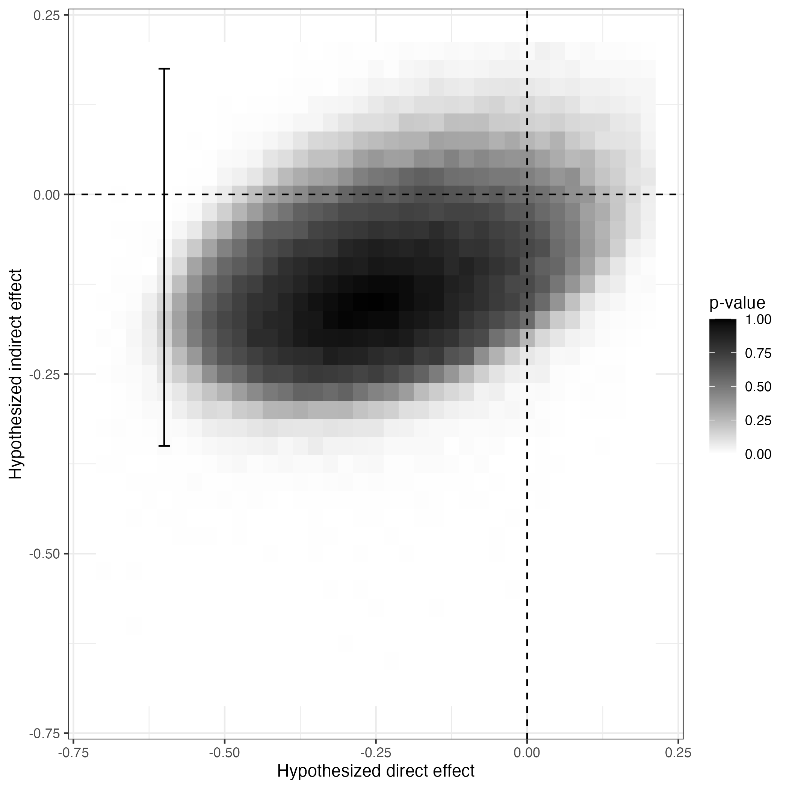
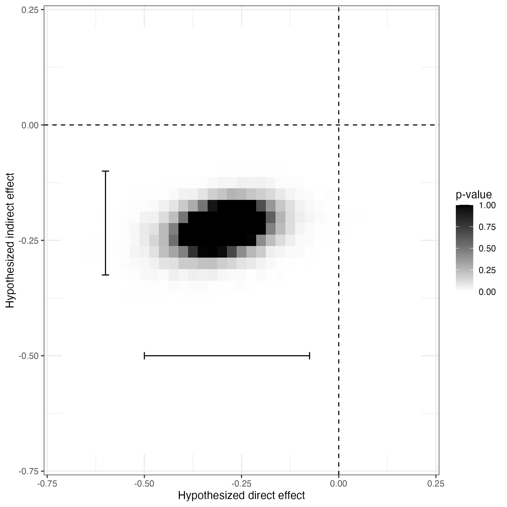
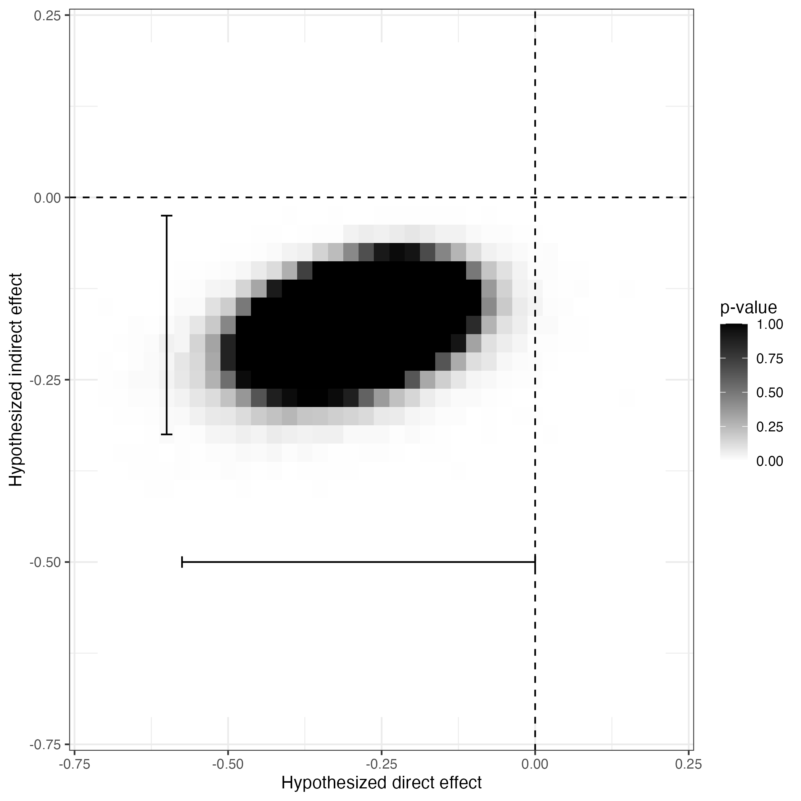
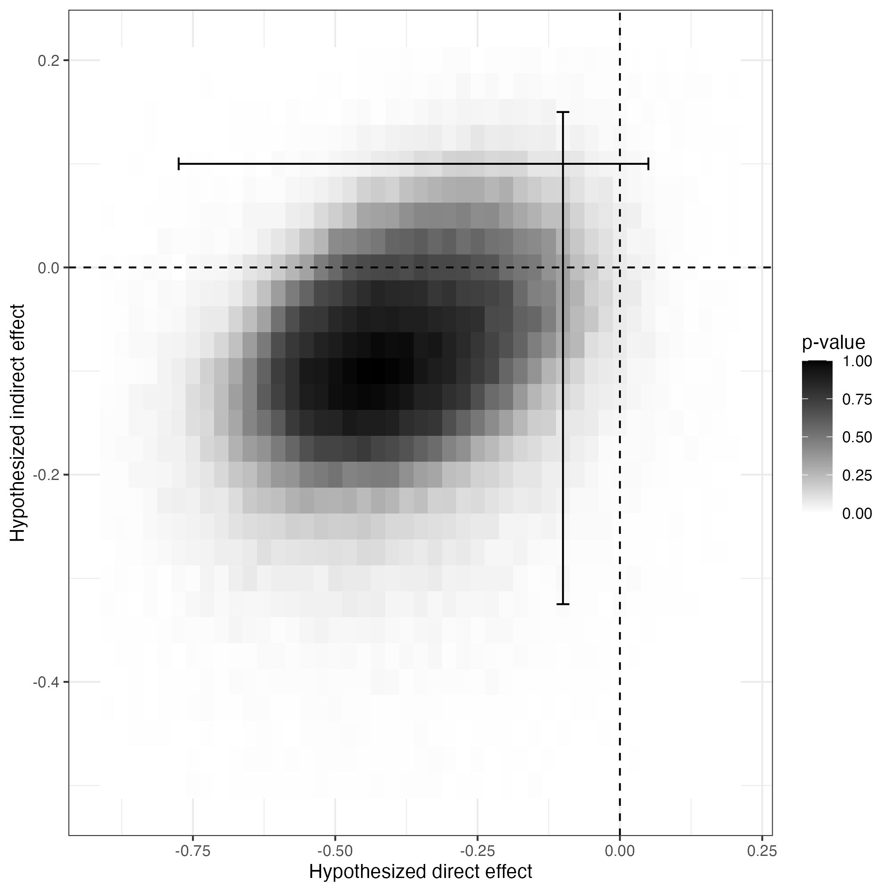
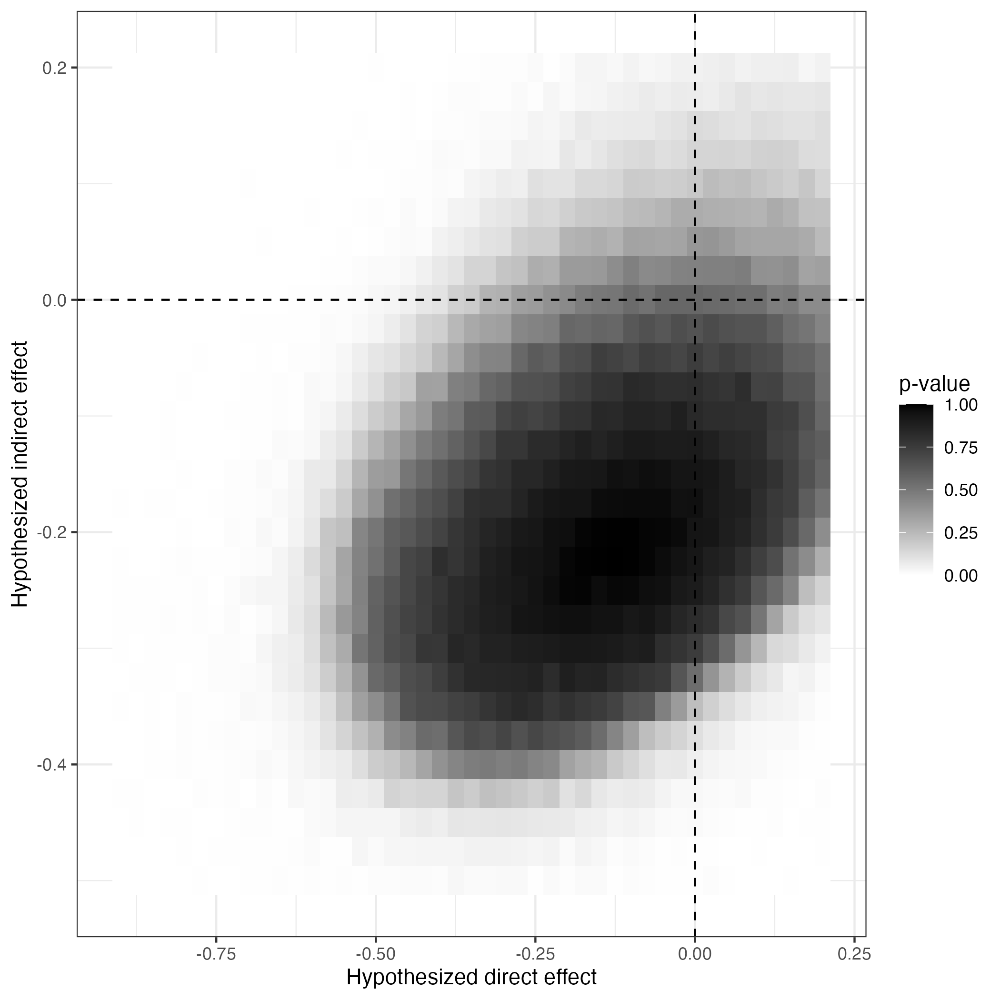
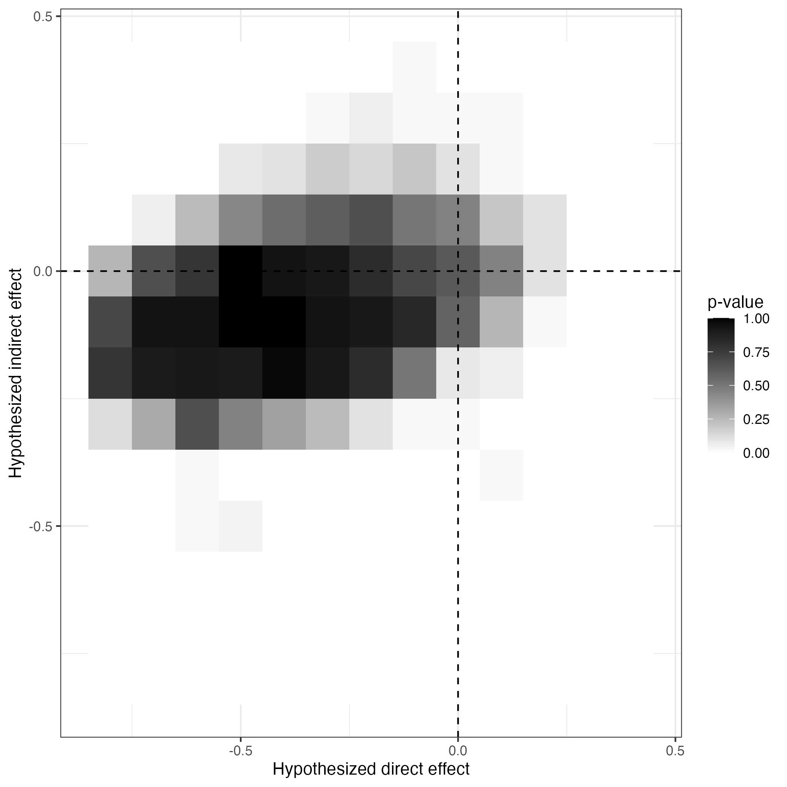
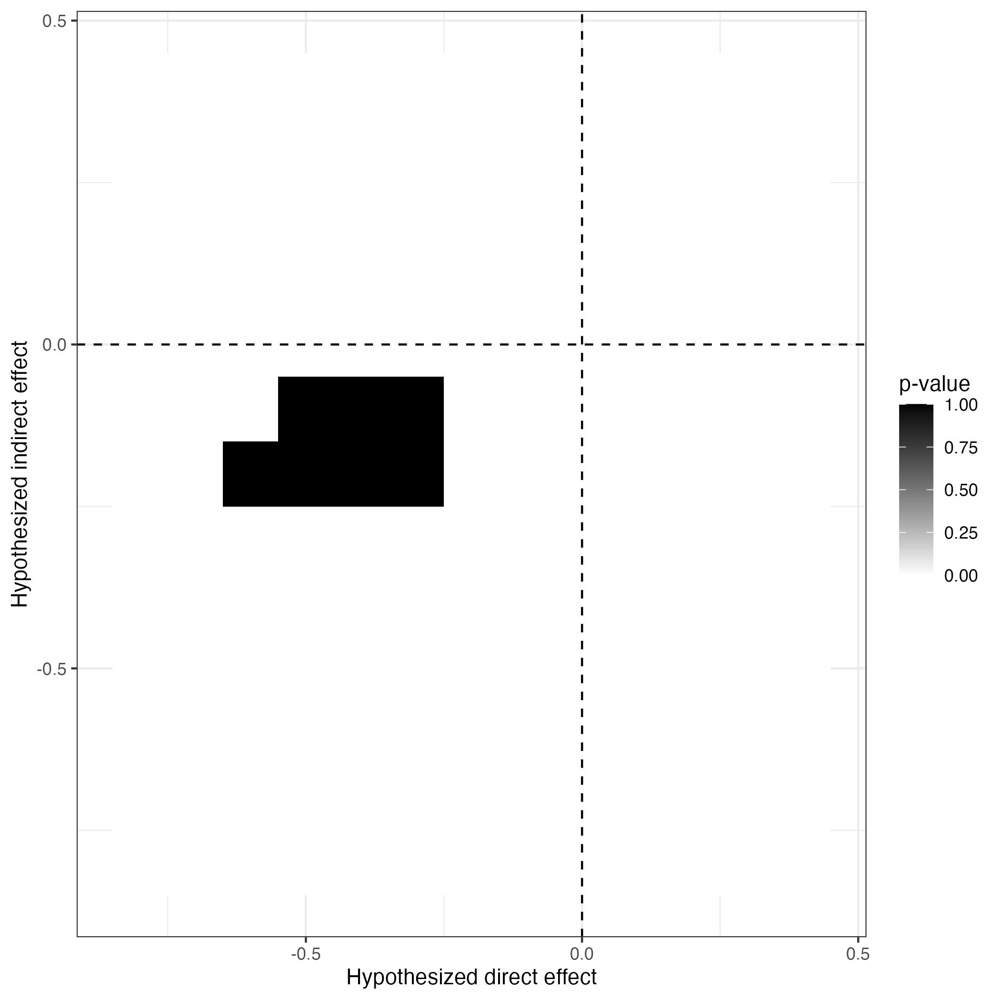

# Active Maintenance Report: coppock_2014

2026-08-01

- [Summary](#summary)
  - [Does the deposited archive run?](#does-the-deposited-archive-run)
  - [Does the maintained rewrite reproduce the
    corrigendum?](#does-the-maintained-rewrite-reproduce-the-corrigendum)
  - [What this repository does not
    certify](#what-this-repository-does-not-certify)
- [Paper overview](#paper-overview)
- [Original archive reproducibility](#original-archive-reproducibility)
  - [The directory that is not in the
    deposit](#the-directory-that-is-not-in-the-deposit)
- [The corrigendum](#the-corrigendum)
- [The extraction and the two
  instruments](#the-extraction-and-the-two-instruments)
  - [What the extraction found that the ground truth had
    not](#what-the-extraction-found-that-the-ground-truth-had-not)
- [Number-by-number comparison](#number-by-number-comparison)
  - [Coverage float by float](#coverage-float-by-float)
- [Maintained rewrite](#maintained-rewrite)
  - [Architecture](#architecture)
  - [Deprecated patterns replaced](#deprecated-patterns-replaced)
  - [Summary tables](#summary-tables)
  - [In-text quantities](#in-text-quantities)
- [Figure verification](#figure-verification)
- [R environment](#r-environment)

*Drafted by Claude Opus 5 under the supervision of Alex Coppock.*

This repository holds the actively maintained replication code for
Coppock (2014) and for the corrigendum that corrects it, together with
the reproducibility report that documents what the original archive did
and did not do. It is part of a program applying the maintenance
proposal in Peer, Orr and Coppock (2021, *PS: Political Science &
Politics*, doi
[10.1017/S1049096521000366](https://doi.org/10.1017/S1049096521000366))
to a set of published archives.

|  |  |
|----|----|
| Article | [10.1017/xps.2014.9](https://doi.org/10.1017/xps.2014.9) |
| Corrigendum | [10.1017/xps.2016.8](https://doi.org/10.1017/xps.2016.8) |
| Replication archive | [10.7910/DVN/28664](https://doi.org/10.7910/DVN/28664) |
| Reanalyzed experiment | Butler and Nickerson (2011), [10.1561/100.00011019](https://doi.org/10.1561/100.00011019) |

The corrigendum is a separately published article with its own DOI, its
own year and its own pagination, so it is cited here in its own right
rather than as an attachment to the 2014 paper. It matters for what
follows: the deposited archive was never updated after it appeared, so
the code at the DOI above still produces the results the corrigendum
retracts.

**The data are not redistributed here.** The deposit is 3.0 MB across 30
files and lives at Harvard Dataverse, which is the only copy this
repository points at. `download_original.R` fetches it and verifies
every file; `original_manifest.csv` pins the file identifiers, sizes and
checksums, so the exact bytes this code was written against are recorded
in version control even though the bytes themselves are not.

**Repository layout.** `maintained/` is the maintained rewrite: one
script per published figure or table, writing to `output/`, which is
committed so a reader can compare a fresh run against it without
downloading anything. `maintained/in_text_claims.R` prints every claim
the published record makes, each beside the sentence that makes it.
`ground_truth/` ties every published number to the code that produces
it: `published_claims.csv` is the extraction of every number the
article, its appendix and the corrigendum print, and
`build_ground_truth.R` assembles the comparison and runs the coverage
gate. `original/` is created by the download script and is deliberately
absent from the repository. This file is the reproducibility report,
also available as a PDF in `report/`.

**License.** CC0 1.0 Universal, matching the terms of the deposit this
repository maintains. See `LICENSE`.

**To reproduce.** Clone or download the repository, open
`coppock_2014.Rproj`, and run:

``` r
source("run_all.R")
```

That fetches the deposit, verifies its 30 files, and produces every
figure and table into `maintained/output/`. Required packages:
tidyverse, sf, spdep, knitr, kableExtra, here. Paths resolve through
`here`, so nothing depends on the working directory. The full run takes
about five minutes, most of it in the four-parameter appendix model. A
successful run overwrites `maintained/output/`, which is committed:
**`git diff` on that folder is the reproduction check.**

# Summary

**What this repository certifies is the corrigendum**, not the article.
The 2016 corrigendum retracts the spillover conclusion of the 2014 paper
and prints corrected estimates in their place. Those are the numbers
this rewrite stands behind.

Coverage is a separate question from certification, and the ground truth
covers the whole published record: every number the article prints,
every cell of its two appendix tables, and every number in the
corrigendum. Where the corrigendum supersedes an article value, the row
records both and says so. Two of the findings below sit entirely outside
the corrigendum’s scope and would have been invisible to a check
organized around the corrected figures.

## Does the deposited archive run?

Not as deposited, and the reason is structural rather than package rot.
Every figure script opens with
`load("Replication Archive/CoppockJEPS.rdata")` and writes into
`Replication Archive/figures/`. No such directory is in the deposit: all
30 files sit flat at the top level, so the folder structure the code
expects did not survive upload. A reader has to build three directories
before any script runs. That is a five-minute repair and it is invisible
until you attempt it.

Once the directories exist the figure scripts run. The data preparation
script that builds their input does not: it calls `maptools`, which left
CRAN in 2023.

What the archive does not contain is any trace of the correction. The
deposited data still holds the corrupted similarity matrix the
corrigendum describes, so the figures a reader produces from it today
are the ones the corrigendum retracts.

## Does the maintained rewrite reproduce the corrigendum?

Yes, and both of its panels rather than only the corrected one. 3 of the
5 corrected values return exactly, and the two that sit one grid step
away do so for a reason recorded below and not because the analysis
differs. The six values the corrigendum restates from the original
analysis return exactly as well: its four confidence bounds once that
analysis is run on the ideal points the corrigendum used rather than the
deposited ones, and its two point estimates on the article’s own
surface, which is what its sentence describes. That last point took a
while to establish, and it reverses a reading this repository carried
earlier; the section “The corrigendum” below sets out both.

Getting there required two things that are worth stating, because either
one alone leaves the corrigendum looking irreproducible.

**The ideal points are not the deposited ones.** Similarity between
legislators is measured from W-NOMINATE scores estimated on the previous
session’s roll calls. The archive behind the corrigendum carries
different scores from the deposited archive: 68 of the 70 differ, by up
to 0.533, correlation 0.978. The transform that turns scores into a
similarity matrix is byte-identical in both, `(2 - |x - y|)/2` with a
zeroed diagonal, so the matrices differ only because their inputs do.

The cause is a package. Both archives call
`wnominate(rollcalls, polarity = c(1, 2), minvotes = 10)`, identically.
The deposited archive loads the package with no version constraint; the
corrigendum archive pins it, with a comment reading “be sure to use
version 0.98” and a `stopifnot` to enforce it. `wnominate` 0.98 was
current when the analysis was written and 0.99 arrived in September
2014, between the analysis and publication. Running today’s `wnominate`
1.5 on the deposited roll calls puts the result closer to the
corrigendum’s scores (r = 0.993) than to the deposited ones (r = 0.976),
which is the signature of an estimator that moved. The deposited
`datapreparation.R` can no longer regenerate the deposited scores, and
nothing in it says so.

The 70 scores are in `recovered/`, committed because they exist nowhere
public.

**The analysis predates R 3.6.** The p-value surface draws 685,000
times, and R 3.6.0 replaced the algorithm behind `sample()`. Under the
sampler of the day, with the corrected scores, the surface this
repository produces is identical to the one saved in the corrigendum’s
own archive: all 1,369 cells, maximum difference exactly zero.

Those are two different questions and they are kept apart.
`text_sampler_reproducibility.R` re-runs both of the corrigendum’s
panels under `RNGkind(sample.kind = "Rounding")`, because whether the
archive reproduces is a question about the archive. The rewrite itself
keeps the current sampler, because it is the code we would write now.
The two remaining differences are one grid step each and are recorded as
belonging to the environment. The sampler matters to the corrected panel
and not to the original one, which returns the same four bounds either
way, and that asymmetry is what rules the sampler out as the explanation
of the discrepancy taken up below.

One published value is not identified rather than unreproduced. The
confidence region reaches 0.2, the top of the grid, in the corrigendum’s
surface as well as this one, so the printed 0.175 is the last interior
grid point rather than a bound the data support.

## What this repository does not certify

The archive’s figure scripts produce the article’s p-value maps, and
this rewrite reproduces them bit for bit where they can be compared. The
estimates read off those maps are in the ground truth, but as a record
of what the deposit does rather than as results anyone should now use:
the corrigendum supersedes the two figures that carry the coding error,
and the rewrite reads its point estimates by the method the article
describes rather than the one its code implements, which moves three of
them.

Three coding defects in the deposit are worth recording even so, since
none is mentioned by the corrigendum. `CoppockJEPS_appendixfigure4.R`
never calls `set.seed`, so Appendix Figure 4 differs on every run and
cannot be reproduced by anyone. Five scripts read a point estimate off
the first and second entries of a plateau index matrix in column-major
order, which indexes the indirect axis with a position from the direct
one; `figure2code.R` takes the median, which is what the paper
describes. `appendixfigure5.R` draws its assignment vector once outside
the simulation loop, so all fifty draws are the same assignment and
every p-value is 0 or 1, which is visible in the published figure as
solid blocks.

# Paper overview

**Citation**: Coppock, A. (2014). “Information spillovers: Another look
at experimental estimates of legislator responsiveness.” *Journal of
Experimental Political Science*, 1(2), 159-169. DOI: 10.1017/xps.2014.9

**Corrigendum**: Coppock, A. (2016). *Journal of Experimental Political
Science*, 3(2), 206-208. DOI: 10.1017/xps.2016.8

**Summary**: Butler and Nickerson (2011) mailed district-level public
opinion data to 35 of the 70 members of the New Mexico House before a
2008 vote on a tax rebate bill, in a matched-pair randomization, and
estimated the effect of that information on roll call votes. The
reanalysis asks what happens when the non-interference assumption is
dropped, on the grounds that legislatures are information-sharing
networks. Legislators are assumed to be exposed to treatment through
their ideologically similar colleagues, with similarity measured from
W-NOMINATE ideal points estimated on the preceding session’s roll calls.
Inference follows Bowers, Fredrickson and Panagopoulos (2013): each pair
of hypothesized direct and indirect effects implies a uniformity trial,
the hypothesis is re-imposed under draws from the 10,000 admissible
randomizations, and the p-value is the share of draws whose sum of
squared residuals the observed one exceeds. The article concluded that
the total causal effect of treatment was about twice the difference in
means. The corrigendum retracts the spillover part of that conclusion.

# Original archive reproducibility

| Script | Status on current R | Resolution |
|:---|:---|:---|
| CoppockJEPS_10000Randomizations.R | Runs; regenerates a matrix the deposit already carries, under a seed R has since changed | None needed: Z_block is inside the deposited CoppockJEPS.RData |
| CoppockJEPS_datapreparation.R | Fails: maptools is off CRAN, and it writes CoppockJEPS.rdata over the deposited CoppockJEPS.RData | sf::st_read plus spdep::poly2nb rebuilds the one matrix maptools was used for |
| CoppockJEPS_figure1acode.R | Fails on a missing directory; runs once it exists | Create Replication Archive/figures and …/modeloutputs; copy CoppockJEPS.RData in |
| CoppockJEPS_figure1bcode.R | Fails on a missing directory; runs once it exists | As above |
| CoppockJEPS_figure2code.R | Fails on a missing directory; runs once it exists | As above |
| CoppockJEPS_figure3code.R | Fails on a missing directory; runs once it exists | As above |
| CoppockJEPS_appendixfigure2.R | Fails on a missing directory; runs once it exists | As above |
| CoppockJEPS_appendixfigure3.R | Fails on a missing directory; runs once it exists | As above |
| CoppockJEPS_appendixfigure4.R | Fails on a missing directory; runs once it exists, and sets no seed | As above; set.seed(343), as every other script does |
| CoppockJEPS_appendixfigure5.R | Fails on a missing directory; runs once it exists, and its simulation never permutes | As above; draw a fresh assignment per simulation |
| CoppockJEPS_appendixtable.R | Fails: loads seven files by bare name and writes to a hardcoded /Users/Alex path | Run from the modeloutputs directory; redirect the output |

Original archive reproducibility, checked against R 4.6.0 on 1 August
2026.

## The directory that is not in the deposit

The scripts and the deposit disagree about where files live, in both
directions. Every figure script reads
`Replication Archive/CoppockJEPS.rdata` and writes to
`Replication Archive/figures/`; the data preparation script reads
`CoppockJEPSshapefile/hd_court_ordered.shp`. Neither path exists at
Dataverse, where the shapefile’s three components sit at the top level
alongside everything else. The published appendix documents the
shapefile directory as a directory, so this is an upload that flattened
a tree rather than an author who never had one.

Two smaller path defects come with it, and both are invisible on macOS.

`CoppockJEPS_10000Randomizations.R` writes
`CoppockJEPS_10000randomizations.rdata`, with a lower-case r, and
`CoppockJEPS_datapreparation.R` loads
`CoppockJEPS_10000Randomizations.rdata`, with an upper-case one. A
case-insensitive filesystem resolves that; Linux does not.

More seriously, `CoppockJEPS_datapreparation.R` ends by writing
`CoppockJEPS.rdata` into the working directory, and the deposited file
is `CoppockJEPS.RData`. Running the data preparation script inside a
copy of the archive on macOS therefore silently overwrites a deposited
file with a regenerated one. That is why everything in this report was
run from a scratch copy, and why `download_original.R` reports anything
in `original/` that the manifest does not list.

# The corrigendum

The corrigendum is the substance of the case, so it is worth being
precise about which object is wrong.

`CoppockJEPS.RData` stores four similarity matrices. Three of them, the
rank, squared-distance and geographic ones, rebuild from the deposited
ideal points and shapefile exactly. The fourth, `similarity.matrix.dw`,
is 1 in every off-diagonal cell and 0 on the diagonal. It asserts that
every pair of legislators in the New Mexico House is maximally and
identically close in ideological space, which is precisely what the
corrigendum says went wrong.

The corruption is confined to that one object. The net exposure variable
the published regressions use, `s.difs.dw`, was computed from a correct
similarity matrix: rebuilding it from Equation (1) reproduces the
deposited values to fourteen decimal places. The published analysis
therefore regressed the observed outcome on a correctly built exposure
measure while simulating the null distribution with the all-ones matrix.
Under that matrix every unit’s raw exposure is the number of treated
colleagues, which is the same for everyone, so the simulated exposure
carries no variation attributable to the random assignment at all. The
reference distribution is far too narrow, and the confidence regions
that come out of it are far too tight. That is the mechanism behind the
corrigendum.

| Panel     | Quantity              | Corrigendum | Rewrite |
|:----------|:----------------------|:------------|:--------|
| Original  | indirect effect       | -0.225      | -0.225  |
| Original  | direct effect         | -0.300      | -0.3    |
| Original  | indirect 95% CI lower | -0.325      | -0.325  |
| Original  | indirect 95% CI upper | -0.025      | -0.025  |
| Original  | direct 95% CI lower   | -0.575      | -0.575  |
| Original  | direct 95% CI upper   | 0.000       | 0       |
| Corrected | indirect effect       | -0.150      | -0.15   |
| Corrected | direct effect         | -0.250      | -0.25   |
| Corrected | indirect 95% CI lower | -0.325      | -0.35   |
| Corrected | indirect 95% CI upper | 0.200       | 0.175   |
| Corrected | direct 95% CI lower   | -0.625      | -0.625  |
| Corrected | direct 95% CI upper   | 0.175       |         |

The two panels of the corrigendum’s Figure 1 as it states them and as
the maintained rewrite produces them. The original panel is the analysis
the article published, re-run on the ideal points the corrigendum used;
the corrected panel is the correction it substitutes.

Three things in that table are worth separating.

**The corrigendum’s restatement of the original result describes its own
redrawn panel, and both documents are right.** The corrigendum reports
the original 95% confidence intervals as running from -0.325 to -0.025
for the indirect effect and from -0.575 to 0.000 for the direct effect.
Appendix Table 1 of the 2014 article gives \[-0.3, -0.1\] and \[-0.5,
-0.075\]. The two disagree, and the reason is the ideal points rather
than an error in either.

The uncorrected analysis is not independent of the ideal points, which
is not obvious and is why the disagreement looked for a while like a
defect. Under the all-ones matrix every unit’s raw exposure is the
number of treated colleagues, the same for everyone, so the simulated
exposure varies only through the expected-exposure term of Equation (5),
and that term is built from the similarity matrix the scores define. Run
on the deposited scores the uncorrected model returns the appendix’s
intervals at the precision the appendix prints; run on the scores the
corrigendum was computed from it returns the corrigendum’s, all four
bounds exactly. Each document reports what its own materials produce,
and the sampler is not what separates them: unlike the corrected panel,
this surface gives the same four bounds under the sampler of 2016 and
the current one alike. The point estimates the corrigendum restates are
the article’s own, and they attain the highest p-value on both surfaces,
so no number in that sentence is unsupported.

The corrigendum’s printed figure says the same thing independently. Its
“Original” panel is not the map the 2014 article printed: the article’s
is a rounded blob stopping well short of the vertical zero line, and the
corrigendum’s is wider, tilted along the diagonal, and reaches almost to
zero on the direct axis. Both maps are drawn under Figure verification
below and differ in exactly that way. The difference is a plateau of 90
tied cells against one of 28. The corrigendum redrew the original
analysis rather than reprinting it.

The wider plateau is also why the median over it no longer returns the
pair the corrigendum names. That pair is still at the top of the
corrigendum’s own surface, with a p-value of 1, alongside 89 other cells
tied with it.

All three surfaces are computed here. The article’s Figure 2 and the
corrigendum’s two panels are separate objects in `maintained/output/`,
and no number is transcribed from either document.

**The correction reproduces exactly, once two things are supplied that
the deposit does not carry.** Rebuilding the ideological similarity
matrix from the deposited ideal points and rerunning does what the
corrigendum says qualitatively, widening both intervals across zero, but
it returns neither the corrected point estimates nor the corrected
intervals. Seeds, simulation counts, grid width and the matrix diagonal
were each varied and none of them closes the gap.

The gap closes on the ideal points. The corrigendum was computed from a
different set of W-NOMINATE scores than the deposit carries, and the
difference traces to an unpinned package, as the Summary sets out. With
those scores, and with the sampler of the day restored, the p-value
surface this repository produces is identical to the one saved in the
corrigendum’s own working archive: all 1,369 cells, maximum difference
exactly zero.

**The archive nonetheless records none of that.** It was released in
2015 and never revised, so a reader who downloads it today gets the
retracted figures, the scores that no longer regenerate, and no
indication that either is the case. A corrigendum that corrects a
published analysis is itself a published analysis, and this one was
never deposited.

The corrigendum prints two sets of values: the corrected estimates it
substitutes, and a restatement of the original ones it is correcting.
Both are recorded.

Of the corrected set, 3 of 5 return exactly. Of the restatement, all six
return exactly, once each is laid against the panel it describes. The
corrigendum gives the original direct interval as -0.575 to 0.000 where
the 2014 appendix gives a narrower one, and this repository reproduces
both.

# The extraction and the two instruments

Two things stand between a published sentence and a silent error, and
they are separate files that reach the same number by separate routes.

**The extraction.** `ground_truth/published_claims.csv` records every
numeric token in the article, its online appendix and the corrigendum,
together with the numbers those documents spell out in words. It has 140
rows, classified by hand as 15 definitional, 25 descriptive, 77
pipeline, 23 structural. A `pipeline` claim is an estimate the code
produces; a `descriptive` claim asserts a shape, a sign or a comparison
rather than a value; `structural` and `definitional` claims are design
facts and properties of the formulas. The extraction is what makes
coverage a question with an answer: 115 of the 140 rows are claims the
pipeline can reach, and each must be printed by a claim block.

**The ground truth.** `ground_truth/coppock_2014_ground_truth.csv` has
116 rows, each pairing what a document prints against what
`maintained/output/` produces. 89 carry a value comparison, of which 72
agree at the precision the page prints and 17 do not; 25 are descriptive
claims carrying a computed truth value instead, and all 25 hold. It is
generated by `ground_truth/build_ground_truth.R`, which reads every
rewrite value out of `maintained/output/` rather than transcribing it.

**The second instrument.** `maintained/in_text_claims.R` carries each
sentence verbatim in a block comment and recomputes its number from the
same committed output, reaching it by its own path. Where the ground
truth reads a cell of appendix Table 1 out of
`table_1_constant_effects.csv`, the claims file reads the same cell out
of the figure script’s own CSV. It never reads the ground truth.

**The gate.** `build_ground_truth.R` runs the claims file as a program,
under `capture.output` and in its own environment, and stops the build
unless the number of printed claims equals the number of extraction rows
that require one, the two sets of identifiers are equal in both
directions, every printed value equals the ground truth’s at the same
precision, every extracted transcription equals the ground truth’s, and
every row carrying an adverse verdict from either instrument names where
the fault lies. A block that errors, prints nothing, or quietly reads an
empty selection fails it.

**There is no errata document.** Every value in this article that the
data do not support is already corrected by a published corrigendum,
which carries its own DOI and its own citation, so a note here would
duplicate the published record rather than add to it. The one exception
is recorded below and has not been written up unilaterally.

## What the extraction found that the ground truth had not

| Claim | Published | Here | Where |
|:---|:---|:---|:---|
| 2^35 possible random assignments, called 30 trillion two sentences later | 30 | 0.03436 | paper_internal |
| Figure 1b lower-support estimate in the text, against -0.375 in appendix Table 2 | -0.37 | -0.375 | matches |
| Figure 3a direct effect, read as the median over the plateau the article describes | -0.550 | -0.475 | archive |
| Appendix Table 1 geographic indirect effect, from the one unseeded figure script | -0.025 | 0.025 | archive |

Four claims outside the corrigendum’s scope, none of them reachable by a
check organized around published floats.

The first is the only one that could warrant a correction of its own.
The article writes the number of possible matched-pair random
assignments twice: once as $2^{35} = 3.4 \times 10^{10}$, which the
deposit confirms, and once, two sentences later, as “the 30 trillion
random assignments”. Thirty trillion is $3 \times 10^{13}$, three orders
of magnitude above the count the same paragraph gives. Nothing turns on
it, no estimate moves, and the corrigendum does not mention it.

The second is not an error. Appendix Table 2 gives -0.375 and the
pipeline reproduces it; the main text prints -0.37, which is the same
number truncated rather than rounded, and at two decimals the two sit
exactly on the rounding boundary.

The third and fourth are properties of the deposited code rather than of
the article. `CoppockJEPS_figure3code.R` takes its point estimate from
the first and second entries of the plateau index matrix in column-major
order, so where the plateau spans more than one cell it reads a row
position off the direct axis and uses it to index the indirect one;
Figure 3’s lower-support plateau spans 77 cells.
`CoppockJEPS_appendixfigure4.R` never calls `set.seed`, so the sign the
appendix prints for the geographic placebo’s indirect effect is a
property of one draw.

# Number-by-number comparison

| Document                    | Rows | Compared | Agreeing | Descriptive | Holding |
|:----------------------------|-----:|---------:|---------:|------------:|--------:|
| Article and appendix (2014) |  100 |       78 |       63 |          21 |      21 |
| Corrigendum (2016)          |   16 |       11 |        9 |           4 |       4 |

The ground truth by document. Every published number in both is covered;
the full table is the committed ground truth CSV.

`value_script`, the column recording what the deposited scripts print,
is empty throughout. This repository has no portable
`extract_archive_values.R`, so the rule that the archive column be
generated rather than typed is unmet here, and an empty column is a more
honest statement of that than a transcribed one. What the deposited code
produces is recorded instead in the section below, where the rewrite’s
p-value surfaces are compared with the archive’s cell by cell.

## Coverage float by float

A float with one row in the ground truth is not a covered float, so the
table below states the fraction. The p-value maps print no numbers on
their faces beyond axis ticks chosen by the plotting device, so what
each one asserts is the estimate and confidence region read off it,
which the article states in prose, in appendix Table 1 or 2, or in both.

| Float | Claims covered | Notes |
|:---|:---|:---|
| Figure 1a | 4 of 4 |  |
| Figure 1b | 3 of 3 |  |
| Figure 2 | 5 of 5 |  |
| Figure 3 | 9 of 9 |  |
| Appendix Figure 1 | no stated values | Prints no numbers; the 68 ideal points it plots are counted instead |
| Appendix Figure 2 | 7 of 7 |  |
| Appendix Figure 3 | 8 of 8 |  |
| Appendix Figure 4 | 8 of 8 |  |
| Appendix Figure 5 | 2 of 2 | Prints no numbers and has no summary table; covered by the parameter count and the comparison with Figure 3 |
| Appendix Table 1 | 27 of 27 |  |
| Appendix Table 2 | 18 of 18 |  |
| Corrigendum Figure 1 | 12 of 12 |  |
| Corrigendum Figure 2 | no stated values | The corrigendum states no values for its corrected Figure 3, so there is nothing to compare against |

Coverage of every float in the article, its appendix and the
corrigendum.

| Location | Quantity | Published | Here | Where the fault lies |
|:---|:---|:---|:---|:---|
| Text, p. 162 | The same set of random assignments, in units of 10^12 | 30 | 0.03436 | paper_internal |
| Text, p. 166 | Figure 3a direct effect, lower-support districts | -0.550 | -0.475 | archive |
| Text, p. 166 | Figure 3a indirect effect, lower-support districts | -0.125 | -0.175 | archive |
| Text, p. 166 | Figure 3b direct effect, higher-support districts | -0.175 | -0.1875 | archive |
| Appendix Table 1 | Indirect 95% CI, rank_distance, bound 2 | 0.175 | 0.15 | unresolved |
| Appendix Table 1 | Indirect 95% CI, squared_distance, bound 1 | -0.35 | -0.325 | unresolved |
| Appendix Table 1 | Direct 95% CI, geographic_contiguity, bound 1 | -0.38 | -0.37 | archive |
| Appendix Table 1 | Direct 95% CI, geographic_contiguity, bound 2 | 0.08 | 0.09 | archive |
| Appendix Table 1 | Indirect Effect, geographic_contiguity | -0.025 | 0.025 | archive |
| Appendix Table 1 | Indirect 95% CI, geographic_contiguity, bound 2 | 0.145 | 0.15 | archive |
| Appendix Table 2 | Direct Effect, High Support, absolute_distance_uncorrected | -0.175 | -0.1875 | archive |
| Appendix Table 2 | Direct 95% CI, High Support, absolute_distance_uncorrected, bound 1 | -0.45 | -0.4 | unresolved |
| Appendix Table 2 | Direct Effect, Low Support, absolute_distance_uncorrected | -0.55 | -0.475 | archive |
| Appendix Table 2 | Direct 95% CI, Low Support, absolute_distance_uncorrected, bound 1 | -0.825 | -0.8 | unresolved |
| Appendix Table 2 | Indirect Effect, Low Support, absolute_distance_uncorrected | -0.125 | -0.175 | archive |
| Corrigendum Figure 1, corrected panel | indirect 95% CI lower | -0.325 | -0.35 | environment |
| Corrigendum Figure 1, corrected panel | indirect 95% CI upper | 0.200 | 0.175 | environment |
| Corrigendum Figure 1, corrected panel | direct 95% CI upper | 0.175 | not identified | paper_internal |

Every row where a published value and this repository disagree, with the
cause.

# Maintained rewrite

The rewrite lives in `maintained/`: a cleaning script and a helpers
file, nine figure scripts, two table scripts, two scripts for the
in-text quantities, the sampler reproducibility check, and
`in_text_claims.R`.

## Architecture

`clean_data.R` is the load-bearing one. It reads the deposited
`CoppockJEPS.RData`, rebuilds all four similarity matrices from the
deposited ideal points and shapefile, and prints how far each rebuilt
matrix sits from the deposited one, which is what localizes the defect:
three deviations of zero and one of 1. It then computes expected and
observed net exposures for each matrix, and keeps the deposited all-ones
matrix alongside the corrected one so that the uncorrected figures can
be reproduced rather than described.

Every spillover figure is therefore computed twice, once from each
matrix, and both versions go into `output/`. Figure 2 is computed three
times, because the corrigendum’s original panel is a third surface: the
published all-ones matrix on the corrigendum archive’s ideal points.
Nothing is transcribed: the corrigendum’s numbers appear in the ground
truth as comparison targets and nowhere in the code.

The p-value grid itself is one function, `pvalue_grid()` in `helpers.R`,
taking the similarity matrix, the expected exposures and the observed
exposure as separate arguments. That separation is deliberate. The
difference between the published analysis and the corrected one is
exactly which matrix goes into the simulation while the observed
regressor stays the same, and a helper that fixed either of them
internally would hide the only choice in the paper that matters.

The rewrite’s p-value matrices were checked cell by cell against the
ones the deposited scripts save. Six of the seven are bit-identical:
Figure 1a’s 71 cells, Figure 1b’s 2,205, Figure 2’s 1,369, Figure 3’s
1,305, Appendix Figure 2’s 1,681 and Appendix Figure 3’s 2,401, with a
maximum absolute deviation of exactly zero in every case. Appendix
Figure 4 is the exception, and only because its script sets no seed.
Agreement at that level is what makes the point-estimate differences
interpretable: the surfaces are the same, so any difference in what is
read off them is a difference in the reading.

**One defect that comparison could not catch, and a published figure
did.** `tile_grid()` turned a p-value matrix into long form with
`expand_grid(x = directs, y = indirects)`, a direct port of the
deposit’s `expand.grid` call. Base `expand.grid` varies its first
argument fastest and tidyr’s `expand_grid` varies its last, and the
matrix is read column-major, so the two axes were swapped and every
p-value map this repository drew was the transpose of its own estimates.
No estimate was affected: point estimates and confidence regions come
from the fit object rather than from the plot, which is why cell-by-cell
agreement with the archive’s matrices passed throughout. It surfaced
only when a map was laid beside the one the corrigendum prints. The
argument order and the reason for it are now recorded in `helpers.R`.

The test statistic goes through `.lm.fit` rather than `lm`. The rewrite
fits about eleven million regressions; `lm` takes 0.295 milliseconds
each and `.lm.fit` takes 0.0035, and the two agree on the sum of squared
residuals to floating point. That is the difference between a
five-minute run and an hour-long one, and a reproduction check nobody
runs is not a check.

## Deprecated patterns replaced

| Original pattern | Replacement |
|:---|:---|
| `rm(list = ls())` | (omitted) |
| `setwd("")` and `Replication Archive/` paths | `here::here()` |
| `maptools::readShapeSpatial` | `sf::st_read` + `spdep::poly2nb` |
| `lattice::levelplot` + `larrows` | `ggplot2::geom_tile` + `annotate("segment")` |
| `pdf()` / `dev.off()` | `ggsave()`, PDF and PNG |
| `xtable` + `sink()` to a hardcoded path | `write_csv()` to `output/` |
| `save()` / `load()` of .rdata | `write_rds()` / `read_rds()` |
| nested `for` loops over `data.frame(...)` + `lm()` | design matrices + `.lm.fit` |
| `Z_block[, 1]` inside the simulation loop | `z_block[, sample(ncol(z_block), 1)]` |

Deprecated patterns and their replacements in the maintained rewrite.

## Summary tables

|  | No spillover | Absolute distance | Absolute distance (uncorrected) | Absolute distance (corrigendum’s original panel) | Rank distance | Squared distance | Geographic |
|:---|:---|:---|:---|:---|:---|:---|:---|
| Direct Effect | -0.16 | -0.25 | -0.3 | -0.3 | -0.225 | -0.25 | -0.15 |
| Direct 95% CI | \[-0.34,0.02\] | \[-0.625,NA\] | \[-0.5,-0.075\] | \[-0.575,0\] | \[-0.45,0.1\] | \[-0.525,0.325\] | \[-0.37,0.09\] |
| Indirect Effect |  | -0.15 | -0.225 | -0.175 | -0.2 | -0.175 | 0.025 |
| Indirect 95% CI |  | \[-0.35,0.175\] | \[-0.325,-0.1\] | \[-0.325,-0.025\] | \[-0.325,0.15\] | \[-0.325,0.525\] | \[-0.095,0.15\] |
| Corresponding Figure | 1a | 2 | 2 | 2 | A2 | A3 | A4 |

Appendix Table 1, constant effects models, as the maintained rewrite
produces it. The uncorrected column is the analysis the article
published; the column beside it is that same analysis on the ideal
points the corrigendum used.

|  | No spillover | Absolute distance | Absolute distance (uncorrected) |
|:---|:---|:---|:---|
| Direct Effect, High Support | 0.05 | -0.125 | -0.1875 |
| Direct 95% CI, High Support | \[-0.225,0.35\] | \[-0.65,NA\] | \[-0.4,0.075\] |
| Indirect Effect, High Support |  | -0.225 | -0.3 |
| Indirect 95% CI, High Support |  | \[-0.45,NA\] | \[-0.425,-0.175\] |
| Direct Effect, Low Support | -0.375 | -0.425 | -0.475 |
| Direct 95% CI, Low Support | \[-0.675,-0.05\] | \[-0.775,0.05\] | \[-0.8,-0.125\] |
| Indirect Effect, Low Support |  | -0.1 | -0.175 |
| Indirect 95% CI, Low Support |  | \[-0.325,0.15\] | \[-0.325,0\] |
| Corresponding Figure | 1b | 3 | 3 |

Appendix Table 2, heterogeneous effects models, as the maintained
rewrite produces it.

## In-text quantities

| Quantity                                              | Value |
|:------------------------------------------------------|:------|
| Legislators treated                                   | 35    |
| Difference-in-means estimate (Figure 1a)              | -0.16 |
| Implied change in votes under the difference in means | -5.6  |
| Legislators voting yea                                | 51    |
| Yea votes in the uniformity trial, uncorrected        | 61.46 |
| Total causal effect in votes, uncorrected             | 10.46 |
| Yea votes in the uniformity trial, corrected          | 59.64 |
| Total causal effect in votes, corrected               | 8.64  |

The page 167 arithmetic, under both similarity matrices.

The article states that 61 legislators would have voted yea in the
uniformity trial against 51 who actually did, for a total causal effect
of 10 votes, roughly twice the 5.6 the difference in means implies. The
uncorrected column reproduces that. The corrected column is the quantity
the corrigendum’s conclusion bears on: the point estimates barely move,
so the arithmetic barely moves, and what changes is that neither effect
can be distinguished from zero.

# Figure verification

The correction’s visible consequence is the width of the shaded region.
The uncorrected map is a tight blob well away from both axes; the
corrected map spreads across zero on both. The third map is the same
uncorrected analysis on the corrigendum’s ideal points, and it sits
between them: still short of zero on the indirect axis, but reaching it
on the direct one. The corrigendum prints two panels, and they are the
first and third of these; the second is the article’s own Figure 2,
which the corrigendum does not reprint.
















# R environment

| Item      | Value                  |
|:----------|:-----------------------|
| R version | 4.6.0                  |
| Platform  | aarch64-apple-darwin23 |
| Date run  | 2026-08-03             |

| Package | Version |
|:--------|:--------|
| dplyr   | 1.2.1   |
| ggplot2 | 4.0.3   |
| tidyr   | 1.3.2   |
| purrr   | 1.2.2   |
| readr   | 2.2.0   |
| sf      | 1.1.2   |
| spdep   | 1.4.2   |
| here    | 1.0.2   |

Package versions used for the run behind this report.
